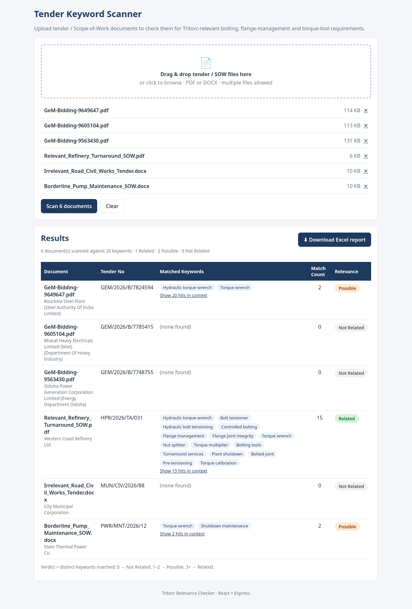

# Tritorc Tender / Scope-of-Work Keyword Scanner

Upload one or more tender / SOW documents (PDF or DOCX). The app extracts the text, scans it for Tritorc-relevant keywords (bolting, flange management, torque tools), gives each document a relevance verdict, and produces a downloadable Excel report.

**Stack:** React (Vite) frontend · Node.js + Express REST API · multer · pdf-parse · mammoth · exceljs · Jest.



## Run locally

Requirements: Node.js 18+ (tested on 20.19).

```bash
# 1. Backend  (http://localhost:4000)
cd backend
npm install
npm start            # or: npm run dev  (auto-reload)

# 2. Frontend (http://localhost:5173), in a second terminal
cd frontend
npm install
npm run dev
```

Open http://localhost:5173, drop in files (try `samples/` or the GeM PDFs), click **Scan**, then **Download Excel report**.
In dev, Vite proxies `/api` to the backend, so no CORS setup is needed. Copy `.env.example` → `.env` to change settings.

### Tests
```bash
cd backend && npm test
```
20 Jest tests: matching rules (case, plurals, stemming, hyphens/line breaks, the "extension" ≠ "tension" trap), scoring thresholds, API validation, the three real GeM tenders, the three self-made samples and the Excel layout.

### CLI report (no UI)
```bash
cd backend && npm run report -- ../docs/out.xlsx ../samples/*.pdf ../samples/*.docx
```

## REST API

| Method | Path | Description |
|---|---|---|
| `POST` | `/api/scan` | `multipart/form-data`, field `files` (1–20 `.pdf`/`.docx`, ≤ 20 MB each). Optional field `keywords` (comma/newline list) overrides the default list. Returns `{ scanId, downloadUrl, results[] }`. |
| `GET` | `/api/scan/:scanId/report.xlsx` | Downloads the Excel report for that scan. |
| `GET` | `/api/keywords` | Default keywords and scoring thresholds. |
| `GET` | `/api/health` | Health check. |

Each result has `documentName`, `matchedKeywords`, `matchCount` (distinct keywords), `totalHits`, `relevance`, `matches[]` (every hit with page number and a context snippet) and `metadata` (the tender fields).

## How it works

```
backend/src
├── config/            keywords.csv (the 20 default keywords) + index.js (thresholds, limits)
├── services/
│   ├── extractor.js   PDF (pdf-parse, text kept per page) / DOCX (mammoth)
│   ├── matcher.js     keyword regexes, hits with page + snippet
│   ├── scorer.js      verdict from distinct keyword count
│   ├── metadata.js    regex extraction of tender fields (GeM + generic "Label: value")
│   ├── report.js      exceljs workbook (layout copied from the sample report)
│   └── scanner.js     pipeline for one file
└── routes/api.js      Express routes + multer upload
```

**Keyword matching**
- Case-insensitive and whole-word only, so "extension" is never a hit for "tension" (GeM 9563430 contains "extension").
- Flexible separators: spaces, hyphens and line breaks between words all match (`pre-tensioning` = `pre tensioning` = `pretensioning`).
- Plural/suffix variants and light stemming (the bonus): `wrench/wrenches`, `tensioner/tensioning/tensioned`, `tool/tools`, `tighten/tightening`, `calibrate/calibration`.
- The words of a phrase must be next to each other, so "torque wrench calibration" is not counted as "Torque calibration".

**Relevance verdict:** it's computed from the number of distinct keywords found (not hardcoded). 0 → **Not Related**, 1–2 → **Possible**, 3+ → **Related**. The thresholds live in `config/index.js` (or the `RELATED_MIN` / `POSSIBLE_MIN` env vars). The labels match the provided sample report. The brief's Yes / Possible / No map to Related / Possible / Not Related.

**Excel report:** the layout is copied from `sample_tender_scan_report.xlsx`:
- **Sheet "Tender Scan Report"**
  - The same 24 columns and widths as the sample.
  - Navy `1E3A5F` header with bold white text, frozen at B2, wrap text on.
  - Verdict fills: green `D9F2D9` for Related, amber `FDEBD3` for Possible, grey `F2F2F2` for Not Related.
  - Fields that aren't found read "Not Found" in grey text. Matched Keywords reads "(none found)" when there are none.
- **Bonus sheet "Keyword Hits":** one row per hit, with the document, keyword, matched text, page and context snippet.

**Tender metadata (GeM):** Tender ID is the number in the file name, Tender No is the GeM bid number, Authority is the organisation and department, Location is the office, and the opening and closing dates are the bid opening and bid end dates. Tender Amount is the estimated bid value, EMD comes from EMD Detail, Technical Qualification is the buyer's eligibility criteria, Scope is the item category, Description is the searched strings, and Email is the buyer's email. GeM bids have no Tab Name, Corrigendum, Website or Tender Fee, so those always read "Not Found".

## Results on the provided GeM tenders

| Document | Item | Matched | Verdict |
|---|---|---|---|
| GeM-Bidding-9649647.pdf (SAIL Rourkela) | Hydraulic torque wrench with power pack | Hydraulic torque wrench, Torque wrench (20 hits) | **Possible** |
| GeM-Bidding-9605104.pdf (BHEL Ranipet) | Hydraulic nuts | none | **Not Related** |
| GeM-Bidding-9563430.pdf (OPGC) | Tube beveling machine | none ("extension" correctly ignored) | **Not Related** |

9649647 matches only **2 distinct** keywords, so the 1–2 → Possible rule makes it Possible, even though it is clearly a torque-wrench tender. Lowering `RELATED_MIN` to 2 would make it Related. 9605104 (hydraulic nuts) uses none of the 20 default keywords, so it is Not Related.

## Sample test documents (`samples/`)
Generated by `npm run samples` in `backend/`:
- `Relevant_Refinery_Turnaround_SOW.pdf` → Related (15 keywords)
- `Borderline_Pump_Maintenance_SOW.docx` → Possible ("Torque wrench", "Shutdown maintenance")
- `Irrelevant_Road_Civil_Works_Tender.docx` → Not Related (contains "extension" and "attention" as traps)

## Screenshots
`docs/screenshots/`:
1. Empty upload screen.
2. Files selected.
3. Results.
4. Keyword hits shown in context.
5. Mobile layout.
6. The downloaded Excel report.

Example reports are in `docs/` (`example_report_GeM_tenders.xlsx` and `example_report_all_6_docs.xlsx`, the one downloaded through the UI).

## Limitations
- Scanned or image-only PDFs have no text layer, so they need OCR, which isn't included. The UI shows a warning when almost no text is extracted.
- Scans are kept in memory, last 50, so a restart clears download links. MongoDB scan history would be the next step.
- pdf-parse 1.1.1 uses an older pdf.js and can fail on some unusual PDFs. Each file has its own error handling, so one bad file doesn't stop the batch.
